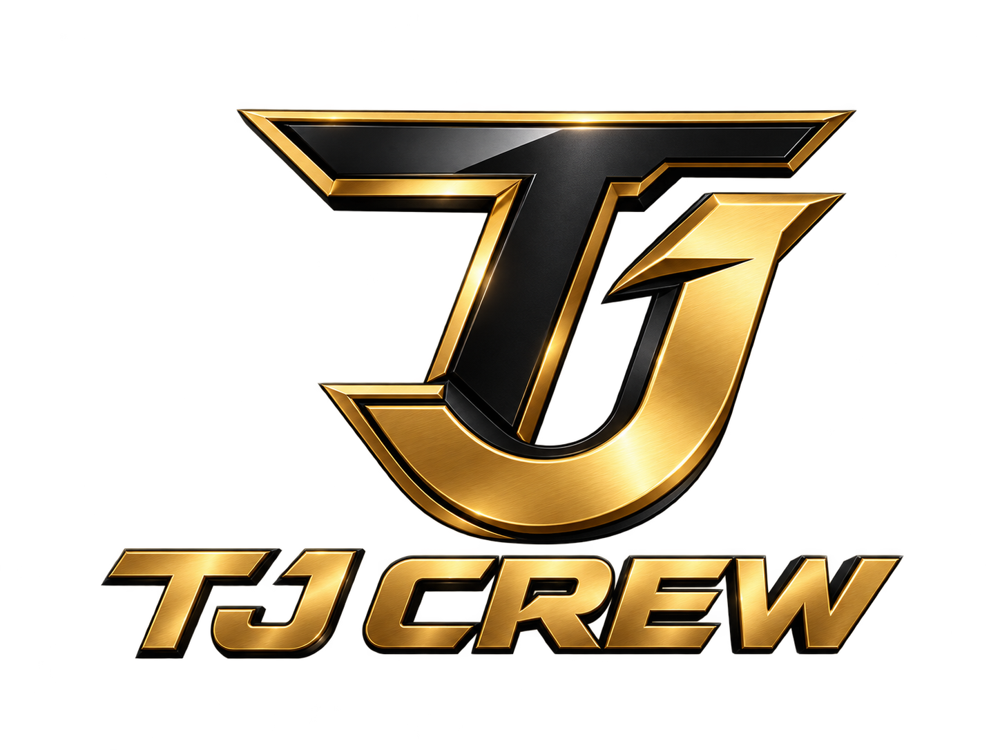

<div align="center">



**A living station where real AI agents do real work.**

[](INSTALL.md)
[](LICENSE)
[](PRIVACY.md)

[Install guide](INSTALL.md) ·
[Run from source](#run-from-source) ·
[Docs](docs/INDEX.md) ·
[Contributing](CONTRIBUTING.md)

</div>

TJ Crew Station is a local-first desktop harness where you create AI agents, organize them into a
station, and watch them perform real work with real models and tools. The
station is not decoration — it is a projection of live runtime state, and the product contract
is literal: **A room is a capability-scoped team**, **a hallway is** an authorized handoff
lane, and **a placed object is a real capability grant**.
The layout you draw *is* the workflow the agents run.

Start with one agent, then place bays or summon specialists to run **more, concurrently** —
each a **genuinely distinct, bounded agent run** with its own workspace and permissions.
The harness performs **real model calls, real tools, real cost** rather than animating a
simulation.

## Features

| | |
| --- | --- |
| **A crew, not a chatbot** | Create agents with distinct classes, personas, and loadouts. Run several at once — each gets its own workspace, transcript, memory, and bounded permissions. |
| **Bring your own models** | Paste an OpenRouter key, or sign in with supported provider accounts (Anthropic, OpenAI, Google) — keys live in the OS keychain, never in the frontend. |
| **Message it from anywhere** | Wire agents to Telegram, Discord, Slack, Signal, or Matrix and talk to your station away from the desk. |
| **Night Shift** | Leave the station running and agents keep working inside an explicit, adjustable leash — every away-action is logged and reviewable. |
| **Recipes, skills, schedules** | Launch proven multi-step recipes, grant reusable skills, and put work on cron schedules with visible output. |
| **Asks before it guesses** | Task Briefs turn ambiguity into one concrete question with options — over any connected channel — instead of a silent wrong guess. |
| **Finished work has a front door** | Deliverables land in the OUTBOX as real files you open, not chat scrollback you archaeology. |
| **MCP connectors** | Attach Model Context Protocol servers and paste-a-key/OAuth connectors to extend what agents can touch. |
| **Voice** | Push-to-talk dictation in, one consistent station voice out. |
| **Real ledgers** | Spend, budgets, and run history persist on disk and are shown as-is. |

## What is real

- Model calls stream through the local Node sidecar.
- Tools operate through explicit capability and consent checks.
- Agent memory, transcripts, spend records, tasks, and schedules persist on disk.
- Multiple agents run concurrently with separate workspaces and bounded permissions.
- The visual station projects the same runtime state the harness can prove.

TJ Crew Station does not simulate revenue, completed work, model activity, or spend. Its core product
law is that **the interface must never assert state the harness cannot prove.**

## Download

Desktop builds are published on the project's releases page (see [INSTALL.md](INSTALL.md) for the
current location and verification steps).

| Platform | Asset |
| --- | --- |
| **Windows** (10/11, 64-bit) | `TJ Crew Station_<version>_x64-setup.exe` |
| **macOS — Apple Silicon** (M1–M4) | `TJ Crew Station_<version>_aarch64.dmg` |
| **macOS — Intel** | `TJ Crew Station_<version>_x64.dmg` |

> **Apple Silicon note:** use the native `aarch64` DMG. Avoid the `x64` DMG on Apple Silicon:
> it runs under Rosetta 2 rather than using the native architecture.

> **Early release:** Windows is the most-tested desktop target. macOS has less real-world
> coverage. Release hosting, code signing, notarization, and the auto-updater endpoint for
> TJ Crew Station are still being set up — until they are, install from a signed release
> linked in [INSTALL.md](INSTALL.md) and verify it per the instructions there.

## Run from source

Requirements: Node.js 18+ (Node.js 22 matches CI), Git. Rust and the
[Tauri prerequisites](https://v2.tauri.app/start/prerequisites/) only for the desktop shell.

The sidecar uses Node core modules only, so it runs without installing anything.
Clone the TJ Crew Station repository, then:

```bash
cd tjcrew-station
node sidecar/index.js
```

Open <http://localhost:8787>, then connect a provider —
**bring your own OpenRouter API key (BYOK)** or use a supported OAuth sign-in. Provider requests leave your machine when you run an agent;
station state, transcripts, memory, and ledgers stay in the local TJ Crew Station workspace unless you
explicitly use a network tool or connector. See [PRIVACY.md](PRIVACY.md) for the full data map.

### Run free with a local model

No key, no account, no bill: install [Ollama](https://ollama.com), pull a model
(`ollama pull llama3.1`), and pick **OLLAMA** as the provider — on the first-run brain screen, or
later in **SETTINGS → PROVIDERS**. The station talks to Ollama on `127.0.0.1:11434` and only reports
it ready once it can list your local models. Honest caveat: local models are smaller than the
cloud ones, so expect slower and rougher work on long tasks.

For desktop development:

```bash
npm ci
npm run desktop:dev     # dev shell
npm run desktop:build   # build installers locally
```

## Coming from OpenClaw or Hermes?

The station can import an existing agent: point it at your on-disk OpenClaw or Hermes home and it
mints a station agent from the persona, instructions, memory, and model it finds. API keys
never transfer — you re-enter those in the KEYS tab.

## Architecture

| Path | Responsibility |
| --- | --- |
| `frontend/` | Station world and desktop UI (vanilla JS, no build step). |
| `sidecar/` | Local Node agent runtime: providers, tools, persistence, budgets, consent. |
| `shared/` | Additive cross-boundary event and schema contracts. |
| `src-tauri/` | Rust/Tauri desktop shell and bundled runtime. |
| `test/` | Unit, contract, integration, and release gates. |
| `qa/` | Live QA receipts, journeys, findings ledger, and release-readiness authority. |

The frontend consumes real sidecar events over localhost HTTP/NDJSON and SSE. Secrets belong
to the local authority:
**Secrets are held by the sidecar / OS keychain, never in the frontend**.

Start with [docs/INDEX.md](docs/INDEX.md) for the living documentation. Older planning
documents remain in the repository as design history and are labeled accordingly.

## Testing

```bash
npm run test:fast          # required merge gate
npm run test:http          # live sidecar HTTP/E2E suite
npm test                   # validation + world + fast + HTTP suites
npm run security:secrets   # full-history secret scan; requires Gitleaks in PATH
```

The release aggregate is `npm run qa:ready`. It is candidate-bound: any new commit invalidates
the prior READY receipt until the affected live gates are rerun.

## Contributing and security

Contributions are welcome — read [CONTRIBUTING.md](CONTRIBUTING.md) and follow the
[Code of Conduct](CODE_OF_CONDUCT.md).

Do not report vulnerabilities in a public issue. Follow [SECURITY.md](SECURITY.md) for private
reporting instructions.

## License

The code in this repository is open source under the [MIT License](LICENSE). Third-party components remain
under their original licenses — see [NOTICE.md](NOTICE.md).

**The MIT License covers the code only.** The **TJ Crew Station** name, the logo, and the rest of
this product's brand identity are owned by TJ Crew and are **not** licensed with it — no trademark
or other brand rights are granted, expressly or by implication.

This product is a derivative of [StarNet](https://github.com/androoAGI/starnet) by Andrew Sims,
used under the MIT License. It is an independent product: forks and derivatives of either project
must use their own name, logo, and artwork, and must not present themselves as the other project
or as endorsed by it.
